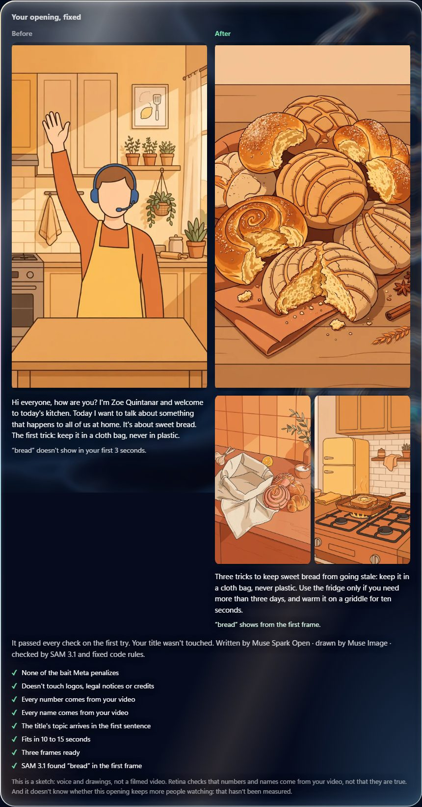

# Retina

*Built with Muse Spark Open.*

**Retina rewrites the first seconds of your video, draws them and checks the fix before you publish.**

Separately, it estimates how many people may stay with the video you have now, and tells you how far off that estimate usually is.



*Made-up example, with drawings by Muse Image. Open it yourself in one minute, with no key: see below.*

Most tools read a video and hand you a grade. Retina hands you a new first 10 to 15 seconds that you can watch and hear. Its core is a
rule engine and a verification loop around Meta's models: the rules run in code, after the model, and send the work back with the exact
list of what failed. One prompt to one model cannot do this.

1. **Watch and listen.** Muse Spark 1.3 describes what is on screen and Muse Voice Transcribe writes down what is said.
2. **Decide whether to touch it.** Muse Spark 1.3 reads the title and the speech. Retina does not rewrite out-of-scope topics or health advice, and
   it says so before spending anything else.
3. **Rewrite.** **Muse Spark Open**, Meta's open-weight model, writes a new opening that gives the first proof of what the title
   promises and leaves the rest to the video. The title itself is never touched. If the opening already works, Spark Open can say so,
   and code has to agree: no greeting, no engagement bait, and the topic in the first 12 words.
4. **Check the words.** Fixed code rules read the result: no greeting, none of the engagement bait on our list of what Meta's distribution
   rules penalize, nothing that touches logos, legal notices or credits, the title's topic in the first sentence, no list that uses up the
   video, and a length of about 10 to 15 seconds. Numbers and mid-sentence names must come from the video.
5. **Read it back.** Before anything is drawn, Muse Spark 1.3 reads the opening against what the video says. If it adds something the
   video does not say, the work goes back.
6. **Draw it.** **Muse Image** draws three frames from what Spark Open wrote.
7. **Check the picture.** **SAM 3.1** looks in the first frame for what the title promises, picked by Muse Spark 1.3 from a closed list
   of objects and places, never people. Spark Open knows what SAM will look for and has to describe it, so a pass means the drawing shows
   what was asked. It does not prove the claim, or that your video shows it. Muse Spark 1.3 then looks at the other frames and says
   whether each one shows what was written.
8. **Correct.** If anything fails, Spark Open receives the exact list of failures and tries again, up to twice. What does not pass
   never reaches you. If one of these checks cannot run, Retina does not approve the opening either: it tells you what it could
   not check, and you can try again.

**A separate number, for the video you have now.** Retina estimates how many of every 100 people who get past the first 3 seconds will
still be watching at 15 seconds. It learned this from 23,710 videos of a large Facebook page in Mexico. It is a modest reference, not a
promise: it is usually off by about 11 people, and 4 times in 10 by more. In 97 to 98 % of videos it sees no difference from the curve
for the video's length, and it says so instead of inventing one. It gives no number for the new opening, because it cannot compare two
versions of one video.

It also warns you when the video does not deliver what the title promises, and checks what is seen and said against 18 of Facebook's
public rules, with the second and the words behind each warning.

## What we measured

Every pass/fail rule was written before its run, and sealed with a commit from 29-Oct on. The full list, including everything that
failed, is in [`docs/results.md`](docs/results.md). The fifth test measured the version published here, on 50 new videos, and met all
nine of its conditions on the first run.

| Question | Result |
|---|---|
| Does a new opening pass every automatic check? | **Passed**: 25 of 30 with a visible promise and 18 of 20 without one, in 2 corrections or fewer. The 7 that failed were withheld, as designed |
| Can the picture check be fooled? | SAM rejected 10 of 10 frames asked for an object of another family, and 8 of 10 asked for a close one: "store" passed on a shop and "dog" on a frame asked for an animal. In the fourth test, with other pairs, "school" passed on a drawn house |
| Does the judge know how to say no? | Yes, on planted failures: it rejected 10 of 10 openings with an invented fact, and said 8 of 10 summaries of the whole video left nothing for the rest |
| Is the new opening faithful, and does it leave something for the rest of the video? | Faithful in 42 of 43, leaves something in 42 of 43, both in 41 of 43. The judge is a model, not people. It knew which opening it was reading, and it is the same model that reads the opening inside Retina, so this says less than it seems |
| Is it clearer than the video's real opening? | With the labels hidden and each pair shown in both orders, the same judge preferred the new one in 35 of 37 firm pairs. It compares clean writing with raw speech, which favors the new one |
| Earlier tests | The first failed (10 of 18). The second passed (29 of 30) as a regression test, not a validation. The third and fourth passed with earlier versions (29 of 30 and 17 of 20; 27 of 30 and 20 of 20) |
| How far off is the number? | Usually by about 11 people out of 100, on creators and dates it had not seen; 4 times in 10 by more. It beats the fixed curve by little |
| Does the new opening keep more people? | **Not measured** |

## Limits we say out loud

- **Retina does not know whether the new opening keeps more people.** We never measured that, and it shows no number for the new opening.
- **It leaves a lot of videos alone.** It does not rewrite out-of-scope topics or health advice, for people or for animals, and when in doubt it
  declines. Of the 234 videos reviewed to pick the fifth test, 125 were out for that reason, so the results above describe the rest of
  that page's archive, not all of it.
- **The tests used the title and the speech, not the video,** on one page's archive. The intervals in the annex count as independent
  cases that are not: 13 of the 30 cases with a promise in the last test were animals.
- **The "after" is a sketch,** drawings and voice, not a filmed video.
- **The number cannot see the first 3 seconds.** Facebook's curve seems to count only people who got that far.
- **Checking is not truth.** Retina checks that numbers and names come from your video, not that they are true. A name at the very start
  of a sentence, or a quantity like "half a ton", can slip past the rules. Ten words are checked through a general one, so "hospital"
  passes with any building.
- **"Your opening already works" is barely tested.** It came up 0 times in the last test's 50 videos and 0 times in its 6 tuning cases.
- **The rules check is a first look,** not a guarantee, and we have not measured it. Meta makes the final call.
- **Measured on one page.** Everything was measured on one large page, in Spanish, mostly horizontal, 1 to 4 minutes. It runs on other
  creators and in English, but we only checked that it runs. Over 4 minutes, the reference curve comes from 20 videos and the panel says so.
- **Spanish and English only.** The new opening comes out in one of those two. A video in another alphabet is declined before spending.

## Try it in one minute (no key, no GPU)

```bash
PYTHONPATH=src python -m retina.demo      # Windows PowerShell: $env:PYTHONPATH="src"; python -m retina.demo
```

You only need Python. It opens a made-up example in your browser, in your browser's language, served only on your machine: the opening
before and after, the corrections it went through, every check it passed, the number and the check against Facebook's rules. The script,
the review card and the rules check are made up. The new opening came out of the real pipeline and the number out of the real formula,
both run on that made-up script.

## Try it with your own video

You need Python 3.12, ffmpeg and your own key for the Meta Model API. On Windows, keep the folder path short (such as `C:\retina`):
in a very long path, `pip` cannot finish installing `openai`, and the review comes out without its card.

```bash
pip install -r requirements.txt
# ffmpeg:  winget install Gyan.FFmpeg  (Windows) · brew install ffmpeg (macOS) · apt install ffmpeg (Linux)
cp .env.example .env          # Windows PowerShell: Copy-Item .env.example .env
# Put your Meta Model API key in MODEL_API_KEY. Add BASETEN_API_KEY for Muse Spark Open; without it, Muse Spark 1.3 does the writing and the number goes without the opening sheet.
PYTHONPATH=src python -m retina.app     # Windows PowerShell: $env:PYTHONPATH="src"; python -m retina.app
```

The app opens at `http://127.0.0.1:8790`. Your video goes to Meta, and to Baseten if you set that key. Drop a video, write its title, and
the review is ready in 3 to 5 minutes (about USD 0.10), and you can watch what each model is doing. Then press **Fix the opening**: you
watch each step happen, and in 1 to 4 minutes you get the before and after (USD 0.05 to 0.25, only when you press the button). Your
spending cap is `RETINA_TOPE_USD` in `.env`. With the contest's free credits, Meta may use what you send; a company that does not want to
send drafts can set `RETINA_SOLO_PUBLICADOS=1`.

From the command line:

```bash
PYTHONPATH=src python -m retina.retina VIDEO --salida FOLDER --titulo "Your title" --con-api --idioma en
PYTHONPATH=src python -m retina.apertura FOLDER --idioma en --aprobar
```

Tests need no key and no private data: `pip install -r requirements.txt`, then `PYTHONPATH=src python -m unittest discover -s tests`.

## Meta models in Retina

| Step | Model | Where it runs | What it does |
|---|---|---|---|
| Rewriting the opening (main step) | **Muse Spark Open** (open weights) | Baseten Model API | Writes the new opening and three frames, and fixes them when a check fails. Without a Baseten key, Muse Spark 1.3 does it |
| Drawing it | **Muse Image 1.0** | Meta Model API | Draws the first frame and, once everything passes, the other two |
| Checking the promise | Muse Spark 1.3 + **SAM 3.1** | Meta Model API | Spark picks what the title promises from a closed list; SAM looks for it in the first 3 s of the draft and in the first drawn frame |
| Deciding whether to rewrite | Muse Spark 1.3 | Meta Model API | Reads the title and the speech and declines out-of-scope topics and health advice, before any other model runs |
| Reading the opening back | Muse Spark 1.3 | Meta Model API | Reads each opening against what the video says, before it is drawn; anything added goes back to Spark Open |
| Checking the other frames | Muse Spark 1.3 | Meta Model API | Looks at each frame SAM did not check; if one does not show what was written, the work goes back to Spark Open |
| Checking the title | Muse Spark 1.3 | Meta Model API | Compares the title with what is said and shown. A warning only: the title is never changed |
| Checking Facebook's rules | Muse Spark 1.3 | Meta Model API | Reads the description and transcript against a closed list of 18 public rules; code drops any warning without real evidence |
| Watching and listening | Muse Spark 1.3, Muse Voice Transcribe 1.0 | Meta Model API | What is on screen, speech with timestamps and silences |
| Reading the opening, writing the card | **Muse Spark Open** (open weights) | Baseten Model API | Fills a fixed sheet about how the opening starts; writes what works and what is weak, checked by a validator. Muse Spark 1.3 rescues |
| Switching language | Muse Spark 1.3 | Meta Model API | Translates the review when you change the language, once. A translation that changes a number or adds bait is dropped |

### What is not a Meta model

- **The reference number** is a ridge regression fitted offline on Badabun's retention data: at runtime, a JSON file of fixed weights
  that plain Python multiplies and adds. It adjusts the average curve for the video's length, writes nothing and decides nothing. Ridge in
  closed form, λ = 300, 1,703 inputs to the 41 points of the curve, on 23,710 of 32,906 videos; the rest were left out for eligibility,
  no record of it, or out-of-scope topics and out-of-scope topics. Of those used, 9,003 have no opening sheet and 974 no speech. The weights are in
  [`modelos/retina-publico.json`](modelos/retina-publico.json) and the method in [`docs/numero.md`](docs/numero.md). The organizers ruled on
  30-Oct-2026 that ridge coefficients are acceptable when explained this way. `RETINA_SOLO_MODELOS_META=1` turns it off.
- **The voice in the preview** is your browser's own speech synthesis, which may be a neural voice from your system or browser. Retina
  does not call it through an API, and it is not a Meta model.
- **Whisper** transcribed the archive for training, offline. It never runs in the app.
- **ffmpeg** cuts the video. **V-JEPA 2** (Meta's open weights) was research only and is not needed.

## What existed before, and what we built

Before 26-Oct-2026, Badabun already had these, and they stay private:

- the list of published videos with their 41-point Facebook retention curves, its Graph API reader and its servers;
- 30,467 Whisper transcripts of that archive;
- 4,409 published videos matched to their files and reviewed by hand;
- an internal note with earlier figures on the same curves.

Everything else was built during the event, from 26-Oct-2026 on: the code in this repository, the rest of the transcripts, the fitted
weights and every figure here, including the ones that note already had. One overlap: `src/retina/transcribir_local.py` repeats a little
logic from a private script of 16-Oct, about 3 of its 60 long lines. It only prepared training data. The code that matched curves, files
and transcripts reads internal file names, so it is not in this repository.

The day-by-day diary is in [`BUILD-LOG.md`](BUILD-LOG.md), in Spanish, with an English summary in
[`docs/decisions-summary.md`](docs/decisions-summary.md). The services, the agent and the app are in
[`docs/architecture.md`](docs/architecture.md).

## Team

Built for the Meta Global AI Developer Hackathon 2026, theme *Build for Your World*.

**Jossafat Ruvalcaba** built Retina, directing Claude Code, which the organizers allow. **Marco Zuno**, COO of Badabun, is the team's
representative and owns this repository. Commits carry Jossafat's name.

## Security

Found a flaw? Please report it in private: see [SECURITY.md](SECURITY.md).

## License

The code is under the [MIT License](LICENSE). The weights in `modelos/retina-publico.json` are not: they follow the [Muse Model License](LICENSE-MUSE.md).
See [`NOTICE`](NOTICE). Built with Muse Spark Open.
